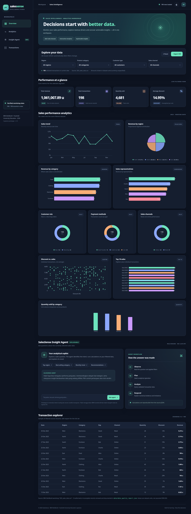
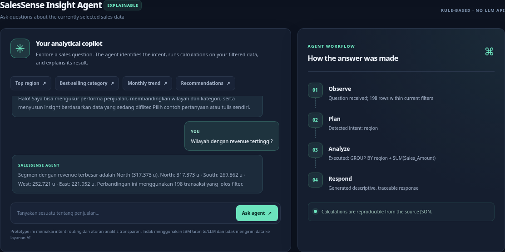

# SalesSense — Sales Intelligence Dashboard & Explainable Insight Agent

[](https://github.com/RadenAlta/raden-dimas-digital-portfolio)  

A portfolio-ready sales analytics application built for the **IBM SkillsBuild University Education × Hacktiv8 — AI Agent for Data Analysis** workshop, November 2026. Developed and reviewed using **IBM Bob**. This repository contains the complete application, a documented dataset validation pipeline, and reproducible checks.

**Demo:** after publishing this repository with GitHub Pages (Settings → Pages → Deploy from branch → main / root), visit `https://radenalta.github.io/salessense-sales-intelligence/`. The address will not work until Pages is enabled and deployment succeeds.

**[Existing portfolio](https://radenalta.github.io/raden-dimas-digital-portfolio/)** · **[GitHub profile](https://github.com/RadenAlta)**



## The problem

Sales data is difficult to explore efficiently when revenue, transactions, product categories, regions, and customer segments are spread across a spreadsheet. Manual aggregation is slow and prone to interpretation errors, especially when source data contains malformed records.

**SalesSense** transforms a workshop dataset into a responsive dashboard and adds an explainable, question-driven insight assistant. Unlike a black-box conversational demo, each supported response follows auditable calculations against the currently filtered dataset.

## Features

- **4 live KPIs:** revenue, transactions, quantity sold, and average discount.
- **10 charts:** monthly revenue trend, regional revenue **polar area**, category revenue, sales representatives, customer types, payment methods, channels, discount–revenue scatter plot, top transactions, and category quantities.
- **4 connected filters:** Region, Product Category, Customer Type, and Sales Channel, with an instant Reset action.
- **Insight Agent:** accepts simple Indonesian/English questions, maps them to an intent, aggregates the filtered data, and exposes an **Observe → Plan → Analyze → Respond** trace.
- **Useful UX:** responsive desktop/mobile design, dark/light mode, accessible chart labels, transaction table, and CSV export.
- **Transparent data cleaning** with documented source exclusions and validation scripts.



## Verified dataset metrics

| Metric | Value |
| --- | ---: |
| Raw CSV rows | 201 |
| Valid records | **198** |
| Rejected malformed rows | 3 |
| Total revenue | **1,061,007.89 u** |
| Transactions | **198** |
| Quantity sold | **4,681** |
| Average discount | **14.95%** |
| Highest-revenue region | **North — 317,372.74 u** |

**`u` = unspecified dataset units.** The provided dataset does not declare a currency; this project does not imply USD or IDR. Revenue is taken from `Sales_Amount` and not recomputed from quantity × unit price, because those source fields are not consistently aligned.

## Architecture

```text
Workshop CSV → validation & exclusions → data/sales_data.json
                                            │
                                            ▼
Web interface → 4 shared filters → KPIs + 10 charts + table + CSV export
                                            │
User question → intent routing → deterministic aggregation → explained answer
                                   (Observe / Plan / Analyze / Respond)
```

**AI limitation:** The Insight Agent is a **deterministic, rule-based prototype**, not a live IBM Granite, watsonx, Langflow, RAG, or LLM integration. IBM Bob was used as a development/review assistant. There is **no hidden API key** or backend AI call.

## Technology

Semantic HTML5, CSS3, vanilla JavaScript, Chart.js (via public CDN, with offline SVG fallbacks), and JSON. Python 3 scripts handle source preparation and validation. Playwright is used for browser regression testing.

## Publish to GitHub (one-time setup)

1. Go to [github.com/new](https://github.com/new) while signed in as **RadenAlta**. Create a **Public** repository called **`salessense-sales-intelligence`**. **Do not** pre-create a README, .gitignore, or license.
2. Extract this archive on Windows. Open **PowerShell in the extracted folder** and run `./PUBLISH_GITHUB.ps1` (equivalently `.\PUBLISH_GITHUB.ps1`). Git for Windows and GitHub authentication are required.
3. Once the push succeeds, open the new repo **Settings → Pages → Build and deployment: Deploy from a branch → main / (root) → Save**. Visit the demo URL only after GitHub reports a successful Pages deployment.

You can also upload the extracted files through GitHub's **Add file → Upload files** page instead of using the script. Do **not** upload the ZIP as a single repository file; its contents must be extracted first.

## Run locally

Run from the **repository root**, not `index.html` via `file://`, because the dashboard fetches JSON.

```powershell
cd salessense-sales-intelligence
py -m http.server 8080
```

Open `http://localhost:8080` and test the question **"Wilayah dengan revenue tertinggi?"** in **Insight Agent**.

## Reproduce checks

```powershell
py verify_kpi.py
py verify_agent.py
node --check script.js

# Optional browser regression test
py -m pip install playwright
py -m playwright install chromium
py tests/test_dashboard.py
```

The browser test checks the offline SVG fallback, key KPIs, filter/reset workflow, agent response, and mobile overflow; a successful test does **not** prove the external Chart.js CDN is available.

## Data provenance and reuse

- Original teaching dataset: [200_sales_data.csv — IBM SkillsBuild × Hacktiv8 workshop](https://drive.google.com/file/d/1gIV-unupWtXoHMMqwHdFqwoZGo9I-80S/view).
- The committed `data/sales_data.json` contains **198 validated records** derived from that dataset.
- `data/data_quality_report.json` documents **3 excluded source rows**, original source SHA-256, and cleaning criteria.
- To reproduce data preparation, download the original CSV from the workshop link to `data/200_sales_data_original.csv`, then run `py prepare_data.py`. The original workshop CSV is **not redistributed** in this repository.
- Source material and dataset are credited for educational purposes. **No reuse license for the workshop dataset is asserted here**.

## Quality and scope

The final workshop version was reviewed using IBM Bob and locally re-tested: **198 records**, **10 charts**, **4 KPI checks**, filter reset, intent routing, and **0 browser page exceptions** in the documented test environment. See [quality report](docs/VALIDATION.md) for limitations and reproducibility. Source checks also run automatically on GitHub Actions for pushes and pull requests.

This is an **independent student project**, not an official IBM or Hacktiv8 product. No credentials, Google Forms responses, or IBM Bob account screenshots are included in the public repository. No license to reuse personal content is granted unless separately stated.

---

**Created by [Raden Dimas Taufik Rahmat](https://github.com/RadenAlta)** · Asia Cyber University · 2026
